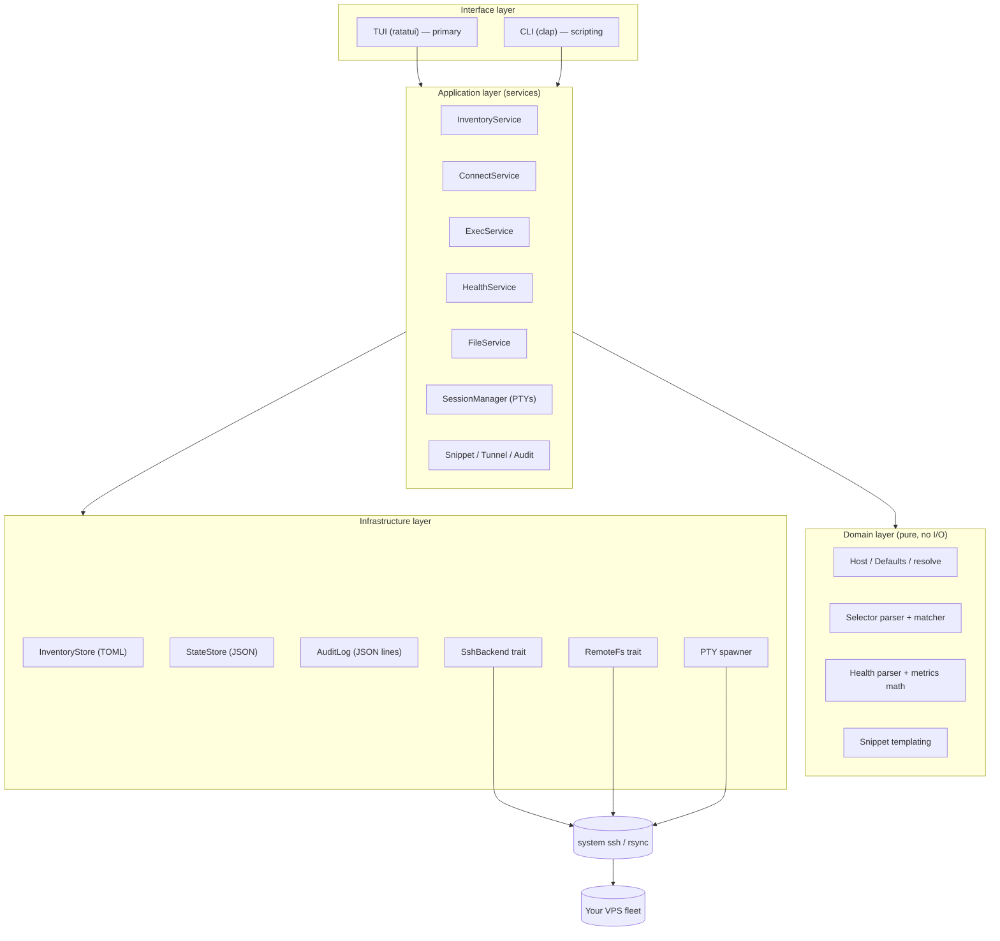
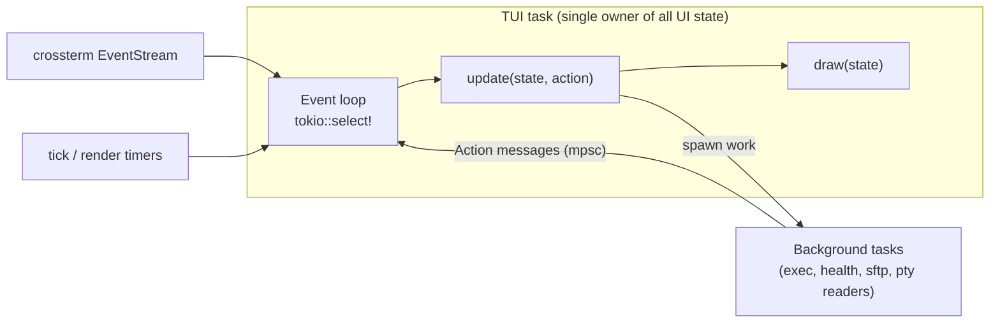
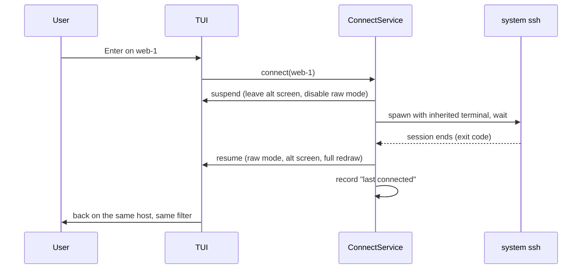
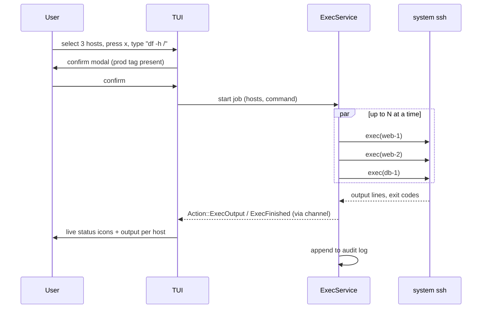

# 02 — Architecture

## Big picture

`vcon` is a single Rust binary whose main interface is a **ratatui TUI**. It
does **not** reimplement SSH. It manages an inventory, works out *which* hosts
and *what* to do, then drives the system's OpenSSH tools to do the actual work:

- `ssh` for interactive sessions, commands, and health checks
- `ssh` running the SFTP subsystem for the file browser
- `ssh` inside a pseudo-terminal (PTY) for embedded sessions
- `rsync` (optional) for fast directory sync



## Layers and their rules

| Layer | Responsibility | Rule |
|-------|----------------|------|
| **Interface** | Turn input into requests, render results. The TUI is the main consumer; the CLI is a thin second one. | No business logic. Calls services, renders state. |
| **Application** | Use cases: "connect to X", "run Y on these hosts", "list remote dir", "refresh health". | Orchestrates domain + infrastructure. Owns concurrency, cancellation, confirmations policy. **Knows nothing about ratatui.** |
| **Domain** | Data types and pure logic: hosts, selectors, parsing health output, templating. | **No I/O at all.** Trivially unit-testable. |
| **Infrastructure** | Files on disk, spawning processes, PTYs, SFTP. | Hidden behind traits so services can be tested with fakes. |

Dependencies only point **downwards**. The rule that services know nothing
about ratatui is what keeps the CLI cheap to add and the services testable.

## How services talk to the TUI

The TUI must never block on the network. Services expose **async functions**
and long-running work reports progress through **channels**:



- The UI task is the **only** place that mutates UI state. Background tasks never touch it; they send `Action` messages (e.g. `HealthUpdated(host, report)`, `ExecOutput(job, host, line)`, `SessionOutput(session_id)`).
- `update` is a pure-ish function: given state + action, change state and optionally return *commands* ("spawn exec job", "open sftp"). The loop executes commands. This keeps `update` testable without a terminal or network.

Full detail: [06-tui-design.md](06-tui-design.md#internal-architecture).

## The key abstractions

### `SshBackend` (commands and interactive handoff)

Operations (described here, not coded):

- **interactive(host)** — hand the whole terminal to an `ssh` session and wait for it to end.
- **exec(host, command, timeout)** — run a command non-interactively; return stdout, stderr, exit code, duration. A streaming variant yields lines as they arrive.
- **copy(host, direction, local, remote, options)** — bulk transfer with rsync/scp (used for "sync directory" and CLI push/pull).
- **forward(host, tunnel spec)** — start a port forward, return a handle that can be stopped.

### `RemoteFs` (file browser)

- **list(dir)**, **stat(path)**, **mkdir**, **rename**, **remove**, **read(path) → stream**, **write(path) ← stream**.
- v1 implementation: an SFTP client speaking the SFTP protocol over a system `ssh -s sftp` subprocess (see [D13](05-decisions.md#d13-file-browser-uses-sftp-over-system-ssh)).

### `SessionManager` (embedded terminals)

- Spawns `ssh -t` inside a PTY (`portable-pty`), feeds PTY output into a terminal-emulator parser (`vt100`), and exposes each session's screen for rendering (`tui-term`). Forwards key presses and resizes to the PTY. See [D12](05-decisions.md#d12-embedded-sessions-pty--vt100-parser).

Why traits: services can be tested with fakes (`FakeBackend`, `FakeRemoteFs`), and implementations can be swapped (e.g. a native `russh` backend later) without touching services or UI.

### The ssh command builder

A single **pure** function turns a resolved host + options into an argument
list. Every feature reuses it (interactive, exec, sftp, pty, rsync `-e`, scp),
so port, key, jump host, and multiplexing are consistent everywhere:

- `-p <port>`, `-i <identity>`, `-J <jump>`, `user@address`
- Non-interactive calls add `-o BatchMode=yes` and `-o ConnectTimeout=<n>`
- Connection reuse: `ControlMaster=auto`, `ControlPath=<cache>/cm/%C`, `ControlPersist=10m` — after the first connection, health polls, exec, and sftp skip the handshake.

## Source layout

Start as **one crate** with modules.

```
src/
├── main.rs              # no args → TUI; subcommand → CLI handler
├── error.rs
├── paths.rs
├── config.rs            # settings, keymap, theme
├── domain/
│   ├── host.rs          # Host, Defaults, resolve()
│   ├── selector.rs
│   ├── health.rs        # parse + derived metrics
│   ├── tunnel.rs
│   └── snippet.rs
├── services/
│   ├── inventory.rs
│   ├── connect.rs
│   ├── exec.rs          # jobs, streaming results, cancellation
│   ├── health.rs        # polling scheduler, history ring buffers
│   ├── files.rs         # browsing + transfer queue
│   ├── sessions.rs      # embedded PTY sessions
│   ├── snippets.rs
│   ├── tunnels.rs
│   └── audit.rs
├── infra/
│   ├── inventory_store.rs
│   ├── state_store.rs
│   ├── audit_log.rs
│   ├── ssh_config.rs        # ~/.ssh/config parser for import
│   ├── ssh/
│   │   ├── command.rs       # pure argument builder
│   │   ├── backend.rs       # SshBackend trait
│   │   └── system.rs        # SystemSsh implementation
│   ├── remote_fs/
│   │   ├── mod.rs           # RemoteFs trait
│   │   └── sftp.rs          # SFTP over system ssh
│   └── pty.rs               # PTY spawning + vt100 parser wrapper
├── tui/                     # see 06-tui-design.md for details
│   ├── mod.rs               # run(): setup, loop, teardown
│   ├── terminal.rs          # raw mode, alt screen, panic hook, suspend/resume
│   ├── event.rs             # merges input, ticks, background messages
│   ├── action.rs            # the Action enum
│   ├── app.rs               # AppState + update()
│   ├── keymap.rs            # key → action per context
│   ├── theme.rs
│   ├── widgets/             # reusable: table, input, form, modal, toast, gauge
│   └── screens/
│       ├── hosts.rs         # list + tag tree + detail pane
│       ├── host_form.rs
│       ├── import.rs
│       ├── exec.rs
│       ├── health.rs
│       ├── files.rs
│       ├── sessions.rs
│       ├── snippets.rs
│       └── log.rs
└── cli/
    ├── mod.rs               # clap definitions
    └── commands/            # list, import, check, connect, exec, status, ...
```

## Files on disk

| Purpose | Default path | Format | Who edits |
|---------|-------------|--------|-----------|
| Inventory | `~/.config/vcon/hosts.toml` | TOML | You + vcon |
| Settings, keymap, theme | `~/.config/vcon/config.toml` | TOML | You |
| Snippets | `~/.config/vcon/snippets.toml` | TOML | You + vcon |
| State (recents, health cache, UI state) | `~/.local/share/vcon/state.json` | JSON | vcon only |
| Audit log | `~/.local/state/vcon/audit.jsonl` | JSON lines | vcon only |
| Debug log (TUI can't print to stderr) | `~/.local/state/vcon/vcon.log` | text | vcon only |
| SSH control sockets | `~/.cache/vcon/cm/` | sockets | OpenSSH |

`VCON_CONFIG_DIR` overrides the base directory (useful for tests and separate
inventories). See [D4](05-decisions.md#d4-file-locations).

## Key flows

### Connect (terminal handoff)



### Parallel exec



## Concurrency model

- **tokio** multi-threaded runtime. The TUI loop is one task; everything slow is a spawned task.
- A global **semaphore** caps concurrent ssh processes (default 10) so health polls + exec jobs + sftp don't open 200 connections at once.
- Every background job has a **cancellation token** (`tokio_util::sync::CancellationToken`): closing the exec panel or quitting vcon kills child processes cleanly.
- PTY readers are blocking reads → run them on `spawn_blocking` threads (or dedicated threads) and forward bytes over a channel.

## Error handling

- Typed errors (`thiserror`) in domain/infra: `HostNotFound`, `DuplicateHost`, `InvalidSelector`, `ConfigParse { line, message }`, `SshAuthFailed`, `HostKeyChanged`, `Timeout`, …
- `anyhow` at the edges (CLI handlers, TUI command execution) to add context.
- In the TUI, errors become **toasts** (short, auto-dismiss) or **error modals** (when the user must act). They never crash the app.
- Multi-host operations: one host failing never aborts the others.
- CLI exit codes: `0` success, `1` error, `2` usage error, `3` "some hosts failed".

## Logging

- `tracing` with `tracing-subscriber` + `tracing-appender` writing to the **log file** (stderr is unusable while the TUI owns the screen).
- `-v` / `-vv` or `VCON_LOG=debug` raise verbosity. At debug, log every ssh command line.
- Optional: a hidden in-app log viewer (e.g. `tui-logger` crate) toggled with a key — very handy while developing.
- Never log secrets or full command output at info level.

## Testing strategy

| Level | What | How |
|-------|------|-----|
| Unit | Selectors, host resolution, ssh arg builder, health parser, templating, key→bytes encoding for PTYs | Plain `#[test]`s on domain code. High coverage here; it's cheap. |
| TUI update | Keyboard flows: search, select, open form, confirm modal | Feed `Action`s/key events into `update`, assert on state. No terminal needed. |
| TUI render | Screens look right | ratatui `TestBackend` + `insta` snapshots. |
| Service | Exec concurrency, partial failures, cancellation, transfer queue | `FakeBackend` / `FakeRemoteFs`. |
| Store | TOML round-trip, comment preservation, atomic writes, import | `tempfile` + fixtures. |
| CLI | Commands, `--json`, exit codes | `assert_cmd` + `predicates`. |
| Integration | Real SSH, SFTP, PTY | Docker `openssh-server` containers (one as bastion). Run in CI. |

## Crate shortlist

| Need | Crate | Phase |
|------|-------|-------|
| TUI | `ratatui`, `crossterm` (with `event-stream` feature) | 0 |
| Async | `tokio`, `tokio-util`, `futures` | 0 |
| CLI parsing | `clap` (derive) | 0 |
| Errors | `thiserror`, `anyhow` (or `color-eyre`) | 0 |
| Logging | `tracing`, `tracing-subscriber`, `tracing-appender` | 0 |
| Directories | `directories` or `etcetera` | 0 |
| Config | `serde`, `toml`, `toml_edit` | 1 |
| Fuzzy matching | `nucleo` (or `fuzzy-matcher`) | 1 |
| Globs | `globset` | 1 |
| Tag/group tree | `tui-tree-widget` | 1 |
| Typo suggestions | `strsim` | 1 |
| Text inputs / forms | `tui-input` or `tui-textarea` | 3 |
| Progress (CLI) | `indicatif` | 4 |
| Charts | ratatui built-ins (`Sparkline`, `Chart`, `Gauge`) | 5 |
| SFTP | `openssh-sftp-client` (drives system ssh) | 6 |
| Embedded terminals | `portable-pty`, `vt100`, `tui-term` | 7 |
| Clipboard | `arboard` (or OSC 52 escape sequence) | 4+ |
| Time | `jiff` or `chrono` | 5 |
| Testing | `insta`, `assert_cmd`, `predicates`, `tempfile`, `proptest` | all |
| Release | `clap_complete`, `clap_mangen`, `cargo-dist` | 9 |

Check each crate's current version and docs when you reach its phase; the TUI
ecosystem moves quickly.
