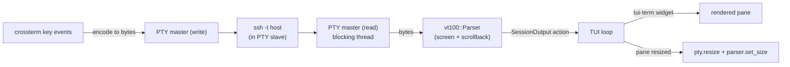

# Phase 7 — Embedded Sessions (Tabs and Panes)

**Goal:** Keep several live SSH sessions open **inside** vcon as tabs and split
panes, switch between them and the rest of the dashboard instantly.

**You can now:** press `o` on a host to open it in an embedded session, open
more, split panes, jump between them with the prefix key, and still use the
Hosts/Health/Files screens while sessions keep running.

**Estimated effort:** 1–2 weeks (the hardest phase)

Reference: [D12](../05-decisions.md#d12-embedded-sessions-pty--vt100-parser), [Session focus and the prefix key](../06-tui-design.md#session-focus-and-the-prefix-key)

## How it works

Enter-to-connect (phase 2) stays the default for "I just need a shell". Embedded
sessions are for multitasking across hosts.

## Step 0 — Spike (do this first, throwaway code)

- [ ] Minimal program: open a PTY with `portable-pty`, spawn `ssh -t <host>`, feed output into `vt100::Parser`, render with `tui-term` in a single full-screen ratatui widget, forward keys. Try bash, vim, htop, `less`, and a resize.
- [ ] Only once this works, integrate into vcon. This de-risks the whole phase.

## Step 1 — `SessionManager` service

- [ ] `open(host) → SessionId`: create PTY at the target pane size, spawn ssh (shared builder, with `-t`), start a reader thread.
- [ ] Reader thread: read bytes from the PTY master → `parser.process(bytes)` (parser behind a `Mutex`, or owned by the reader and snapshotted) → send a coalesced `SessionOutput(id)` action (at most one pending per session, so a flood of output doesn't flood the UI channel).
- [ ] `write(id, bytes)`, `resize(id, rows, cols)`, `close(id)` (kill child, join thread).
- [ ] Detect child exit → `SessionExited(id, code)`; keep the final screen visible with a banner "session ended — Enter to reconnect, x to close".
- [ ] Scrollback size from config (`scrollback_lines`).
- [ ] Optional: record session output to a file (`script`-style), off by default.

## Step 2 — Key encoding (pure, well tested)

Translate crossterm `KeyEvent` → bytes for the remote terminal. Put this in a
pure function with many unit tests:

| Key | Bytes |
|-----|-------|
| printable char | its UTF-8 bytes |
| Enter | `\r` |
| Backspace | `\x7f` |
| Tab / Shift+Tab | `\t` / `\x1b[Z` |
| Esc | `\x1b` |
| Ctrl+letter | letter & 0x1f (Ctrl+C → `\x03`) |
| Alt+key | `\x1b` + key bytes |
| Arrows | `\x1b[A`…`\x1b[D`, or `\x1bOA`… when the app enabled "application cursor keys" mode (check `vt100` screen state) |
| Home/End, PgUp/PgDn, Insert/Delete, F1–F12 | standard xterm sequences |

- [ ] **Paste**: forward crossterm `Paste(text)` events; wrap in `\x1b[200~ … \x1b[201~` if the remote app enabled bracketed paste (vt100 exposes this mode).
- [ ] Mouse (stretch): forward only if the remote app enabled mouse reporting.

## Step 3 — Sessions screen

- [ ] Sub-tab bar listing sessions (`1:web-1  2:db-1*  3:web-2 (ended)`); `*` = new output since last viewed.
- [ ] Layout tree for splits: each tab holds a tree of panes (horizontal/vertical splits) — similar to tmux. Start with: one pane per tab, then add a single split level, then nesting.
- [ ] Focused pane: highlighted border; cursor shown at the vt100 cursor position (ratatui `Frame::set_cursor_position`).
- [ ] On any layout change or terminal resize, recompute pane sizes and call `resize` for every affected session.
- [ ] **Scrollback mode** (`prefix [`): navigate history with arrows/PgUp/PgDn; `Esc` returns to live.
- [ ] **Copy** (stretch): select text in scrollback mode and copy via OSC 52 / `arboard`.

## Step 4 — Input routing and the prefix key

- [ ] When a session pane is focused, **all** keys go to the session except the prefix key (`Ctrl+]` default, configurable).
- [ ] After the prefix: `n/p`, `1–9`, `|`, `-`, arrows, `x`, `[`, `d`, or the prefix again (sends it to the remote). Show a small "PREFIX" indicator while waiting for the second key; time out after ~2 s.
- [ ] `d` (detach focus) returns to normal vcon navigation; the Sessions tab keeps running. Jump back with `4` and Enter.
- [ ] From Hosts/Health: `o` opens a new embedded session for the cursor host (or one per selected host, each in its own tab or tiled in one tab).

## Step 5 — Lifecycle and safety

- [ ] Quitting vcon with live sessions asks for confirmation; on quit, close all sessions cleanly.
- [ ] Reconnect on Enter after a session ends (reuses the same pane).
- [ ] Memory: scrollback per session is bounded; closed sessions free their buffers.
- [ ] Performance: coalesce redraws (render at most `fps` times per second); `cat` a large file in a session and confirm the rest of the UI stays responsive.

## Stretch

- **Broadcast mode**: toggle on a tab to send keystrokes to all its panes (classic multi-server admin feature — guard with a very visible indicator).
- Persist session layout (which hosts were open) and offer to restore on next launch.

## Done when

- You can run htop on one host, tail logs on another, and edit a file in vim on a third — all visible at once in split panes
- Resizing the terminal resizes every session correctly
- Ctrl+C, Ctrl+R, arrows, Tab completion, and paste all behave as in a normal terminal
- Prefix key reliably gets you back to vcon; vcon's own keys never leak into sessions

## Pitfalls

- **Blocking reads**: PTY reads are blocking; never do them on the async runtime's worker threads directly — use dedicated threads or `spawn_blocking`.
- **Rendering cost**: re-rendering every session on every byte will melt the CPU. Only redraw visible panes, at most once per frame.
- **Terminal type**: set `TERM=xterm-256color` for the child so remote apps emit sequences `vt100` understands.
- **Wide characters / emoji** can misalign; acceptable, but test CJK and emoji output once.
- If `vt100` proves too limited for your daily apps, evaluate `alacritty_terminal` behind the same `SessionManager` interface (see D12).
